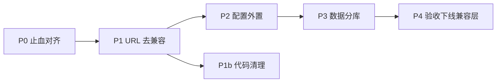

# 微服务「兼容旧单体」收尾优化方案

## 1. 文档信息

| 项 | 内容 |
|----|------|
| 文档名称 | 微服务兼容层（数据 / URL / 配置 / 代码）优化方案 |
| 适用项目 | `wu-admin-cloud` |
| 覆盖端 | Gateway、Auth、BFF、8 个业务微服务、`wu-admin-web`、`wu-admin-uniapp`、SQL、脚本、CI |
| 目标读者 | 架构、后端、前端、移动端、测试、运维 |
| 状态 | Draft v1 |
| 关联文档 | `README.md`、`docs/微服务页面加载性能优化设计.md`、`docs/05-微服务测试与CI设计.md` |

---

## 2. 背景与结论

### 2.1 已完成（逻辑拆分）

当前工程已具备：

- **11 个可运行 JVM**：Gateway / Auth / BFF / 8 个域服务
- **公共库三层**：`wu-cloud-common` → `wu-cloud-api`（Feign 契约）→ `wu-cloud-infra`（Starter）
- **统一入口**：`wu-cloud-gateway` 鉴权、Header 清洗、`/inner/**` 外网拦截
- **跨服务调用**：OpenFeign + `/inner/**` + Fallback（多数）
- **三端客户端**：PC（Vue3）+ 移动端（uni-app）共用网关

### 2.2 未完成（兼容旧单体）

进程已拆开，但以下四类仍在「兼容旧单体」模式：

| 维度 | 现状一句话 | 完成度粗估 |
|------|------------|------------|
| **数据** | 8 个服务逻辑分域，物理仍共用 `wu-admin` 单库 | ~20% |
| **URL** | 前端/菜单沿用单体路径，靠 Gateway `compat-*` Rewrite 翻译 | ~40% |
| **配置** | Nacos 仅做发现；业务配置仍散落各服务本地 YAML | ~30% |
| **代码** | 双轨类型、重复 Controller、遗留路径/脚本未对齐 | ~50% |

> **目标**：在不大改业务能力的前提下，分阶段去掉兼容层，使「逻辑微服务」收敛为可独立演进、可独立部署的「工程化微服务」。

### 2.3 原则

1. **先统一对外契约，再拆物理依赖**（先 URL/代码，再分库）
2. **兼容路由可暂时保留，但必须有淘汰清单与截止日期**
3. **每阶段可回滚**：双写 / 双读 / 特性开关优先于一次性硬切
4. **PC / 移动端同步改**，禁止只改一端导致长期双路径
5. **文档与脚本同步入库**（含启动脚本、SQL、验收用例）

---

## 3. 兼容现状清单（What）

### 3.1 数据层兼容

| 现象 | 证据位置 | 风险 |
|------|----------|------|
| 全部业务库名仍为 `wu-admin` | 各服务 `application.yml` JDBC URL；`sql/01~08` 均 `USE wu-admin` | 无库级隔离；跨域可直连表；故障与备份耦合 |
| SQL 已按域拆文件，运行时未分库 | `sql/01_wu_system.sql` … `08_wu_order.sql` | 「脚本分域」≠「库分域」 |
| 全量基线仍是单体形态 | `sql/admin_platform.sql` | 新人一键导入后难以感知服务边界 |
| 无迁移工具 | 无 Flyway / Liquibase | 环境漂移、上线靠手工 SQL |
| 启动脚本引用缺失脚本 | `scripts/start-services.ps1` 提及 `init-databases.ps1`，仓库中不存在 | 本地初始化不可复现 |

**判定**：属于「Database per Service 未落地」的标准迁移中间态。

---

### 3.2 URL / 路由兼容

网关 `application.yml` 中 **P0-2 兼容性重写路由**（必须置顶）是核心兼容层：

| 兼容路由 ID | 前端/旧路径 | 真实后端 | 目标服务 |
|-------------|-------------|----------|----------|
| `compat-monitor-server` | `/api/system/monitor/server/**` | `/api/monitor/server/**` | infra |
| `compat-monitor-cache` | `/api/system/monitor/cache/**` | `/api/monitor/cache/**` | infra |
| `compat-monitor-job` | `/api/system/monitor/job/**` | `/api/infra/job/**` | infra |
| `compat-monitor-access` | `/api/system/monitor/api-access/**` | `/api/infra/access-log/**` | infra |
| `compat-monitor-online` | `/api/system/monitor/online/**` | `/api/infra/online/**` | infra |
| `compat-config-log` | `/api/system/config-group/sms-logs\|email-logs` | `/api/infra/config-log/**` | infra |
| `compat-codegen` | `/api/system/tool/gen/**` | `/api/infra/codegen/**` | **file**（非 infra） |
| `compat-api-doc` | `/api/doc.html` 等 | `/doc.html` 等 | system |
| `compat-dict` | `/api/system/dict-type\|dict-data` | `/api/system/dict/{type\|data}` | system |
| `wu-service-ai-stream` | `/api/system/ai-stream/**` | `/api/ai/chat/stream/**` | ai |
| `wu-service-ai-biz` | `/api/system/ai-*` | `/api/ai/*` | ai |
| `wu-service-file-api-static` | `/api/files/**` | `/files/**` | file（单体静态路径） |
| `wu-admin-dashboard` | `/api/system/dashboard/**` | BFF 聚合 | wu-admin |

前端实际仍在使用旧路径（示例）：

- PC：`wu-admin-web/src/api/monitor/*.ts` → `/system/monitor/...`
- PC：`wu-admin-web/src/api/tool/gen.ts` → `/system/tool/gen/...`
- PC：`wu-admin-web/src/api/system/ai-*` → `/system/ai-...`
- 移动端：`wu-admin-uniapp/src/api/monitor/*.ts` 同样走 `/system/monitor/...`

**另有「菜单路径 vs API 路径」双轨**：

- 路由/菜单：`system/file`、`system/monitor/job`
- 服务真实前缀：`/api/infra/file`、`/api/infra/job`、`/api/monitor/*`

**判定**：URL 契约仍以单体菜单树为中心，网关充当翻译层。

---

### 3.3 配置兼容

| 现象 | 证据 | 风险 |
|------|------|------|
| Nacos Config 未真正启用 | gateway / message 有 `nacos-config`，但 `import-check.enabled: false`，无 `spring.config.import` | 配置变更需改代码/打包 |
| 无 `bootstrap.yml` | 全仓库无 | 环境差异靠改本地 YAML |
| Sa-Token / Redis / Feign 超时块复制粘贴 | 各服务 `application.yml` | 改一处漏多处，易 Token 不互认 |
| BFF 超时过激进 | `wu-admin` Feign 约 1s/1.2s；auth/system 约 5s/10s | 首屏聚合易误伤降级 |
| message 用原生 Redis starter | 其他服务用 `wu-cloud-starter-redis` | 行为不一致 |
| file 本地目录仍指旧单体 | `FILE_LOCAL_BASE_DIR` 默认 `../../wu-admin-copy/backend/data/uploads` | 依赖已忽略的 `wu-admin-copy` |

**判定**：服务发现已微服务化，配置管理仍是单体式「各写各的」。

---

### 3.4 代码 / 工程兼容

| 现象 | 证据 | 建议归属 |
|------|------|----------|
| 双 `PageResult` | `common.core.PageResult` 与 `common.core.domain.PageResult` | 只保留 `domain.PageResult` |
| 遗留 `CommonResult` | `wu-cloud-common/.../CommonResult.java`，业务已用 `R<T>` | 删除或 `@Deprecated` 后下线 |
| Profile 双入口 | auth：`/api/auth/profile`；system：`/api/system/user/profile`（注释已标兼容） | 正式只保留 auth；淘汰 system 兼容入口 |
| AI 双前缀 | Controller 同时挂 `/api/ai/*` 与 `/api/system/ai-*` | 只保留 `/api/ai/*` |
| 字典双前缀 | `/api/system/dict-type` 与 `/api/system/dict/type` | 只保留规范路径 |
| Codegen 归属漂移 | Starter 在 infra，Controller 部署在 file，compat 注释曾误指向 infra | 明确归属 file 或迁回 infra |
| 启动脚本漏 BFF | `scripts/start-services.ps1` 未启动 `wu-admin` | 与 gateway 路由对齐 |
| 实体命名混用 | `DeptDO` / `SysDeptDO` 等 | 统一 `Sys*` 前缀 |
| Feign 不一致 | `RemoteConfigService` 无 fallback；个别用 `name=` 而非 `value=`+`contextId` | 统一契约模板 |
| `docs/` 被 gitignore | `.gitignore` 第 4 行 `/docs/` | 设计文档无法随仓协作 |
| 双 lockfile | web / uniapp 均有 npm + pnpm lock | CI 只认 npm，易漂移 |

---

## 4. 目标架构（To-Be）

```text
客户端（PC / uni-app）
    │  仅调用「规范路径」/api/{domain}/**
    ▼
Gateway（无 compat Rewrite；仅鉴权、限流、路由）
    │  lb://
    ├── auth        /api/auth/**
    ├── admin(BFF)  /api/admin/**（dashboard 迁入此树或保留别名一期）
    ├── system      /api/system/**（仅 RBAC/字典/配置）
    ├── ticket      /api/ticket/**
    ├── message     /api/message/**
    ├── ai          /api/ai/**
    ├── pay         /api/pay/**
    ├── order       /api/order/**
    ├── file        /api/file/** + /files/**
    └── infra       /api/infra/** + /api/monitor/**

各服务 JDBC → 独立库（或至少独立 schema）：
    wu_system / wu_ticket / wu_message / wu_ai / wu_pay / wu_order / wu_file / wu_infra

配置：
    Nacos Config（按服务 DataId）+ 本地 application.yml 只保留 bootstrap 级项
```

**成功标准（Definition of Done）**：

1. Gateway 中 `compat-*` 路由全部删除，且无 404 回归
2. PC / 移动端 API 模块路径与后端 Controller 前缀 1:1，无 Rewrite 依赖
3. 至少 pay + order 完成独立库；其余服务具备可切换 JDBC 与独立 SQL
4. 公共配置进 Nacos；本地 YAML 无端口/Token/超时复制粘贴差异
5. 无 `CommonResult`、单 `PageResult`、无 system Profile 兼容入口
6. `start-services` / `init-databases` / smoke 与 README 一致；`docs/` 可入库

---

## 5. 分阶段实施计划（How）

建议 **4 个阶段**，每阶段可独立合并、可回滚。总周期视人力约 **6~10 周**（一人全职约 8 周；三人并行可压缩到 4~5 周）。



---

### 阶段 P0：止血与工程对齐（3~5 天）

**目标**：不改对外契约，先消除「脚本/文档/启动与架构不一致」的硬伤。

| # | 任务 | 负责人建议 | 产出 |
|---|------|------------|------|
| P0-1 | `start-services.ps1` 增加 `wu-admin` BFF | 后端 | 仪表盘冷启动可聚合 |
| P0-2 | 补齐 `scripts/init-databases.ps1`（及可选 `.sh`），按序执行 `sql/01~08` 或 `admin_platform.sql` | 运维/后端 | 一键建库 |
| P0-3 | `smoke-test.ps1` 增加 `/api/system/dashboard/stats` 与关键 auth 探活 | 测试 | 冒烟覆盖 BFF |
| P0-4 | file 默认上传目录改为项目内路径（如 `./data/uploads`），去掉对 `wu-admin-copy` 的依赖 | 文件服务 | 可独立运行 |
| P0-5 | 取消或调整 `.gitignore` 对 `/docs/` 的忽略；至少把本方案与性能文档纳入版本库 | 全员 | 文档可协作 |
| P0-6 | 统一前端包管理：删除未使用的 `pnpm-lock.yaml` 或全面切 pnpm（与 CI `npm ci` 二选一） | 前端 | 依赖可复现 |

**验收**：

- 新机器：文档步骤可在 30 分钟内起全量服务并登录
- 不启动 BFF 时 smoke 明确失败；启动后 dashboard 200

---

### 阶段 P1：URL 去兼容（2~3 周）— **优先级最高的业务兼容优化**

**策略**：客户端改路径 → 后端去掉双映射 → 网关删 Rewrite。采用「双轨并行」避免一天硬切。

#### 5.1.1 规范路径约定（定稿）

| 域 | 规范对外前缀 | 禁止继续新增的旧前缀 |
|----|--------------|----------------------|
| 认证 | `/api/auth/**` | `/api/system/user/profile/**` |
| BFF | `/api/admin/**`（仪表盘正式契约 `/api/admin/dashboard/**`） | `/api/system/dashboard/**`（仅双轨过渡，下阶段迁完后删除） |
| 系统 | `/api/system/**`（user/role/menu/dept/post/dict/config） | `/api/system/dict-type`、`dict-data` |
| 监控 | `/api/monitor/**`（server/cache） | `/api/system/monitor/server|cache` |
| 基础设施 | `/api/infra/**`（job/online/access-log/config-log/codegen*、file*） | `/api/system/monitor/job|online|api-access`、`/api/system/tool/gen` |
| AI | `/api/ai/**` | `/api/system/ai-*`、`/api/system/ai-stream` |
| 工单 | `/api/ticket/**`、`/api/approval/**`、`/api/notice/**`、`/api/export/ticket|approval` | `/api/system/ticket|approval|notice|export`（仅双轨过渡） |
| 文件静态 | `/files/**`、`/file/**` | `/api/files/**`（DB 存量 URL 见 P1-静态） |
| 文件 API | **`/api/infra/file/**`、`/api/infra/file-group/**`（已定稿，不迁 `/api/file`）** | — |

> **工单路径说明**：P1.5 已迁出；Gateway 保留 `compat-ticket-legacy` / `compat-ticket-export-legacy` 双轨，待客户端无旧路径后删除。

#### 5.1.2 前端改造清单（PC + 移动端同步）

| 模块 | 现状调用 | 目标调用 | 文件示例 |
|------|----------|----------|----------|
| 监控-server | `/system/monitor/server/*` | `/monitor/server/*` | `api/monitor/server.ts` |
| 监控-cache | `/system/monitor/cache/*` | `/monitor/cache/*` | `api/monitor/cache.ts` |
| 监控-job | `/system/monitor/job/*` | `/infra/job/*` | `api/monitor/job.ts` |
| 监控-online | `/system/monitor/online/*` | `/infra/online/*` | `api/monitor/online.ts` |
| 监控-access | `/system/monitor/api-access/*` | `/infra/access-log/*` | `api/monitor/api-access.ts` |
| 代码生成 | `/system/tool/gen/*` | `/infra/codegen/*` | `api/tool/gen.ts` |
| AI | `/system/ai-*`、`/system/ai-stream` | `/ai/*`、`/ai/chat/stream` | `api/system/ai-*` → 迁到 `api/ai/` |
| 字典 | `/system/dict-type`、`dict-data` | `/system/dict/type`、`/system/dict/data` | `api/system/dict` |
| 配置日志 | `/system/config-group/sms-logs` 等 | `/infra/config-log/*` | config 相关 API |
| 个人中心 | 确认仅 `/auth/profile` | 删除对 `/system/user/profile` 的任何调用 | profile 相关 |

**移动端**：对 `wu-admin-uniapp/src/api/monitor/*`、`api/ai/*` 做同样替换。

**路由/菜单**：

- 侧边栏可继续显示「系统监控」分组（产品体验），但 **页面内 API 必须走规范前缀**
- `router` 中历史 redirect（如 `/system/ai-model` → `/ai/model`）保留；新增页面禁止再注册旧 API 路径

#### 5.1.3 后端改造清单

| 任务 | 动作 |
|------|------|
| AI Controller | 删除 `/api/system/ai-*` 双映射，仅保留 `/api/ai/**` |
| Dict Controller | 删除 `/dict-type`、`/dict-data` 兼容映射 |
| system ProfileController | 标记废弃 → 监控流量 → 删除 |
| Codegen | **进程留 `wu-service-file`**；路径固定 `/api/infra/codegen`（不迁 infra 进程、不改成 `/api/file/codegen`） |
| 静态文件 | 新上传返回 `/files/...`；网关保留 `/api/files` 一个版本周期做 301/Rewrite，同时跑 DB 批量改写脚本 |

#### 5.1.4 网关淘汰节奏

```text
Week1: 前端发版（双端）改新路径；compat 仍保留（双轨）
Week2: 日志统计 compat 命中量 ≈ 0；后端删双映射
Week3: 删除 gateway compat-* 路由；回归全量冒烟 + 核心用例
```

**观测**：在 Gateway 为每个 `compat-*` 增加访问计数（日志或 Meter），连续 7 天命中为 0 再删。

#### 5.1.5 存量静态 URL（头像等）

1. 新写入一律 `/files/...`
2. 提供一次性 SQL/脚本：把 `sys_user.avatar` 等字段中 `/api/files/` 替换为 `/files/`
3. 网关 `wu-service-file-api-static` 保留 **1 个大版本** 后删除

**验收**：

- [ ] PC / uni-app 全局搜索无 `/system/monitor/`、`/system/tool/gen`、`/system/ai-` 作为 API base
- [ ] Gateway 无 `compat-monitor-*`、`compat-codegen`、`compat-dict`、ai Rewrite
- [ ] 回归：登录、仪表盘、用户管理、监控五页、AI 对话、代码生成、文件预览

---

### 阶段 P1b：代码清理（与 P1 并行，约 1 周）

| # | 任务 | 步骤 |
|---|------|------|
| P1b-1 | 统一 `PageResult` | 全仓改为 `com.wu.cloud.common.core.domain.PageResult`；删除 `core.PageResult`；编译 + 单测 |
| P1b-2 | 下线 `CommonResult` | 确认无引用后删除；前端类型注释改为对齐 `R<T>` |
| P1b-3 | Feign 契约模板化 | 所有 `Remote*` 使用 `value` + `contextId` + `fallbackFactory` |
| P1b-4 | 实体命名 | 新代码强制 `Sys*`；旧别名类 `@Deprecated` 后下版本删除 |
| P1b-5 | message Redis | 改为依赖 `wu-cloud-starter-redis` |
| P1b-6 | Feign 超时策略 | 文档化档位：BFF 聚合 / 普通 CRUD / 长耗时（AI/导出）；写入 Nacos 或共享配置片段 |

**Feign 超时档位（P1b-6，本地 YAML 先行，P2 再抽到 Nacos）**：

| 档位 | connect | read | 适用 |
|------|---------|------|------|
| BFF 聚合 | 1s | 1.2s | `wu-admin`：多 Feign 扇出，失败快失败 |
| 普通 CRUD | 5s | 10s | 各业务服务默认 `feign.client.config.default` |
| Gateway→下游 | 3s | （响应超时按路由） | `spring.cloud.gateway.httpclient` |
| 长耗时 | 按调用方覆盖 | AI 流式/大导出建议独立 client 或更长 read | `wu-service-ai` 等可后续加 named config |

**验收**：`mvn -B test` 通过；无 deprecated 兼容类型的新引用。

---

### 阶段 P2：配置外置（1~2 周）

#### 5.2.1 分层模型

| 层级 | 内容 | 存放 |
|------|------|------|
| L0 Bootstrap | 端口、应用名、Nacos 地址 | 本地 `application.yml`（可提交） |
| L1 环境公共 | Redis、MySQL 主机、Sa-Token 公共段、Feign 默认超时 | Nacos：`wu-cloud-common.yaml`（Group=`WU_CLOUD`） |
| L2 服务私有 | 业务开关、线程池、存储路径 | Nacos：`{spring.application.name}.yaml` |
| L3 动态业务 | site/login/security 等 | 已有 DB `sys_config_group`（保持） |

#### 5.2.2 落地步骤

1. 在 Nacos 创建命名空间 `dev` / `prod`，Group `WU_CLOUD`
2. Gateway、Auth、各服务增加：

```yaml
spring:
  config:
    import: optional:nacos:${spring.application.name}.yaml?group=WU_CLOUD&refreshEnabled=true
```

3. 关闭「假依赖」：真正启用后再设 `import-check.enabled: true`
4. 抽出共享片段：`sa-token`、`spring.data.redis`、`feign.client.config.default`
5. 本地仍可 `optional:` 降级，避免无 Nacos 时无法启动开发环境
6. README 增加「配置清单」表：哪些键在 Nacos、哪些在 DB、哪些在本地

#### 5.2.3 密钥与安全

- 数据源密码、支付密钥、AI Key：**不进 Git**；Nacos 加密或环境变量注入
- 已有 SM4 入库字段策略保持；配置中心只存「开关与非密钥参数」

**验收**：

- [ ] 修改 Nacos 中某超时配置，无需重新打包即可对指定服务生效（或滚动刷新）
- [ ] 新环境只需改 Nacos + 少量本地 bootstrap，即可启动

---

### 阶段 P3：数据分库（2~4 周）— **最难、收益最大**

#### 5.3.1 推荐拆库顺序（风险从低到高）

| 批次 | 库名建议 | 服务 | 理由 |
|------|----------|------|------|
| Batch-1 | `wu_pay`、`wu_order` | pay、order | 表边界清晰，跨域少；订单经 Feign 调支付 |
| Batch-2 | `wu_file`、`wu_ai` | file、ai | 相对独立；注意文件 URL 与头像字段 |
| Batch-3 | `wu_ticket`、`wu_message` | ticket、message | 与用户展示有关，需 userId 关联而非 join |
| Batch-4 | `wu_infra`、`wu_system` | infra、system | system 被依赖最多，最后拆 |

> 本地开发可先「一实例多 schema」，生产再「一实例一库」。关键是 **JDBC URL 分离 + 禁止跨库 SQL**。

#### 5.3.2 每库标准动作（Checklist）

1. **盘点表归属**：按 `sql/0X_*.sql` 列出表清单，人工确认无跨域表
2. **扫描跨域访问**：在服务代码中搜其他域表名（如 order 服务是否直接查 `sys_user`）
3. **改跨域为 Feign**：需要用户名/权限时调 `RemoteUserService`，禁止跨库 join
4. **新建库 + 导入对应 SQL**：`CREATE DATABASE wu_xxx; SOURCE 0X_wu_xxx.sql;`（脚本内改库名）
5. **改服务 JDBC URL** 指向新库
6. **双写/校验期（可选）**：对关键表短期校验行数与抽样一致性
7. **切断旧库权限**：该服务 DB 账号仅授权本库
8. **更新 README / init 脚本 / CI**（如有集成测试容器）

#### 5.3.3 迁移工具

短期：

- 完善 `init-databases.ps1`：支持 `-Mode shared|split`
- SQL 文件头部改为可参数化库名

中期：

- 引入 **Flyway**（每服务独立 `classpath:db/migration`），禁止再手工改生产表结构

#### 5.3.4 分布式事务策略（保持现有渐进模型）

- 强一致：Feign + 本地事务（如订单创建）
- 弱一致：已有 Outbox + Quartz 补偿（infra）→ 分库后继续沿用，避免上 MQ 作为分库前置条件

**验收**：

- [ ] Batch-1：pay/order 使用独立库，联调支付闭环通过
- [ ] 各服务 DB 账号 `SHOW GRANTS` 仅见本库
- [ ] 全量回归 + 支付/订单/文件/登录核心用例

---

### 阶段 P4：兼容层下线与加固（3~5 天）

| # | 任务 |
|---|------|
| P4-1 | Gateway 删除全部 `compat-*` 与临时 Rewrite；精简路由表并按「具体路径优先」排序 |
| P4-2 | 删除 system `ProfileController`、AI/Dict 双映射代码 |
| P4-3 | 删除 `/api/files` 兼容路由（确认 DB 已无旧 URL） |
| P4-4 | dashboard 路径：要么正式迁到 `/api/admin/dashboard`，要么保留单一别名并写入长期契约（避免无限期「临时」） |
| P4-5 | 工单若仍挂 `/api/system/ticket`：出专项决议——保留为「系统域 API」或迁 `/api/ticket` |
| P4-6 | CI：增加「禁止新增 compat 路径」的简单 grep 门禁（PR 中出现 `compat-` 新增则失败，除非改白名单） |
| P4-7 | 更新 README「目录结构 / 配置说明 / 部署」；归档本方案为 Accepted |

---

## 6. 详细任务拆解（按仓库路径）

### 6.1 Gateway

| 文件 | 动作 |
|------|------|
| `wu-cloud-gateway/src/main/resources/application.yml` | 分批删除 compat 路由；路由表重排；配置迁 Nacos |
| `filter/*` | 保持鉴权/Inner 守卫；可选增加 compat 命中指标 |
| `scripts/smoke/smoke-test.ps1` | 覆盖新路径，旧路径应 404（下线后） |

### 6.2 后端服务

| 模块 | 动作 |
|------|------|
| `wu-cloud-auth` | 保持 `/api/auth/profile` 为唯一个人中心 |
| `wu-service-system` | 删 Profile 兼容；统一 dict 路径；JDBC 最后拆库 |
| `wu-service-infra` | 规范 `/api/infra`、`/api/monitor`；承接 job/online/access-log |
| `wu-service-file` | Codegen 归属文档化；上传 URL 规范；默认目录修正 |
| `wu-service-ai` | 仅 `/api/ai` |
| `wu-service-message` | 改用 redis starter；配置外置 |
| `wu-admin` | 纳入启动脚本；评估 dashboard 路径 |
| `wu-cloud-common` | 合并 PageResult；删 CommonResult |
| `wu-cloud-api` | Feign 契约统一 |

### 6.3 前端

| 模块 | 动作 |
|------|------|
| `wu-admin-web/src/api/**` | 按 §5.1.2 改路径；AI API 目录归位 `api/ai` |
| `wu-admin-web/src/router` | 保留页面 redirect；API 不再依赖旧路径 |
| `wu-admin-uniapp/src/api/**` | 与 PC 同步 |
| 两边 `package-lock` | 与 CI 对齐，去掉多余 lockfile |

### 6.4 SQL / 脚本

| 路径 | 动作 |
|------|------|
| `sql/01~08` | 支持分库库名；补充「表归属说明」头注释 |
| `sql/admin_platform.sql` | 标注「仅共享库模式」；分库模式改用分脚本 |
| `scripts/init-databases.ps1` | 新建 |
| `scripts/start-services.ps1` | 启动 BFF；修正注释中的库数量描述 |
| `.gitignore` | 放开 `docs/` 或改为忽略草稿子目录 |

---

## 7. 风险与回滚

| 风险 | 影响 | 缓解 | 回滚 |
|------|------|------|------|
| 前端漏改 API | 404/功能不可用 | 双轨期 + compat 计数；全局 grep | 恢复 gateway Rewrite |
| 菜单/权限码未改 | 页面进得去调不通 | 权限字符串与路径解耦（已是 `system:user:list` 风格则影响小） | — |
| 分库后跨库 SQL 报错 | 运行时异常 | 拆库前静态扫描表名；集成测试 | JDBC 切回共享库 |
| Nacos 宕机导致无法启动 | 全站不可用 | `optional:nacos` + 本地兜底 YAML | 关掉 import，纯本地 |
| 静态资源旧 URL | 头像 404 | 批量改写 + 短期兼容路由 | 恢复 `/api/files` Rewrite |
| 一次改太多 | 难定位 | 严格按 P0→P1→P2→P3 | 按阶段回滚 PR |

---

## 8. 测试与验收矩阵

| 场景 | P0 | P1 | P2 | P3 | P4 |
|------|----|----|----|----|-----|
| 登录 / 登出 / 验证码 | ✓ | ✓ | ✓ | ✓ | ✓ |
| 仪表盘聚合 | ✓ | ✓ | ✓ | ✓ | ✓ |
| 用户/角色/菜单 CRUD | | ✓ | | ✓ | ✓ |
| 监控五页 | | ✓ | | ✓ | ✓ |
| AI 流式对话 | | ✓ | | ✓ | ✓ |
| 代码生成预览/下载 | | ✓ | | | ✓ |
| 文件上传/预览/头像 | | ✓ | | ✓ | ✓ |
| 支付下单闭环 | | | | ✓ | ✓ |
| 配置热更新 | | | ✓ | | |
| compat 路由不存在且无 404 回归 | | | | | ✓ |
| 单元测试 `mvn test` + 前端 lint/typecheck/test | ✓ | ✓ | ✓ | ✓ | ✓ |

建议补充（非阻塞但推荐）：

- Gateway → 服务 的 1~2 条契约测试（Testcontainers 或固定 docker-compose）
- 前端对 `api/monitor`、`api/ai` 的路径快照测试（防止再次写回旧路径）

---

## 9. 工作量与优先级建议

| 优先级 | 阶段 | 价值 | 建议 |
|--------|------|------|------|
| **P0** | 工程对齐 | 立刻减少踩坑 | **立即做** |
| **P1** | URL 去兼容 | 去掉最大「假微服务」味道；降低网关复杂度 | **下一迭代主目标** |
| **P1b** | 代码清理 | 降低维护成本 | 与 P1 并行 |
| **P2** | 配置外置 | 多环境必备 | P1 后 |
| **P3** | 数据分库 | 真正隔离 | 按 Batch 推进，勿一次全切 |
| **P4** | 下线兼容 | 防止回潮 | 各项计数归零后执行 |

**不建议**：在未完成 P1（URL）前强行上全面分库——路径混乱时排障成本会翻倍。

---

## 10. 决策待办（需产品/架构拍板）

| # | 议题 | 决议 | 状态 |
|---|------|------|------|
| 1 | 工单/审批 API 是否迁出 system | 迁 `/api/ticket\|approval\|notice`；旧路径双轨过渡 | **已落地（P1.5）** |
| 2 | 仪表盘长期契约 | **`/api/admin/dashboard/**`**（BFF）；旧 `/api/system/dashboard` 双轨后删除 | **已落地**（规范路径 + legacy rewrite） |
| 3 | 文件 API 最终前缀 | **保持 `/api/infra/file`**（含 file-group）；不迁 `/api/file` | **已决议** |
| 4 | Codegen 归属 | **进程留 file 服务**；对外路径 **`/api/infra/codegen`** | **已决议** |
| 5 | 分库粒度 | 仅 schema 分离 vs 独立 MySQL 实例 | **待拍板**（P3 前） |
| 6 | `docs/` 是否纳入 Git | 纳入（去掉 `/docs/` ignore） | **已落地** |

P2 启动前无需再改 1～4；仅剩第 5 项在分库前确认即可。

---

## 11. 附录

### 11.1 兼容路由 → 规范路径速查

```text
/api/system/monitor/server/**     →  /api/monitor/server/**
/api/system/monitor/cache/**      →  /api/monitor/cache/**
/api/system/monitor/job/**        →  /api/infra/job/**
/api/system/monitor/online/**      →  /api/infra/online/**
/api/system/monitor/api-access/**  →  /api/infra/access-log/**
/api/system/config-group/*-logs   →  /api/infra/config-log/**
/api/system/tool/gen/**           →  /api/infra/codegen/**
/api/system/ai-stream/**          →  /api/ai/chat/stream/**
/api/system/ai-*                  →  /api/ai/*
/api/system/dict-type|dict-data   →  /api/system/dict/type|data
/api/files/**                     →  /files/**
/api/system/user/profile/**       →  /api/auth/profile/**（删除前者）
/api/system/dashboard/**          →  /api/admin/dashboard/**（已决议，待迁）
/api/system/ticket|approval|notice → /api/ticket|approval|notice（P1.5 已迁，legacy 双轨）
```

> 文件管理 API **定稿** `/api/infra/file/**`；Codegen **定稿** file 进程 + `/api/infra/codegen`。

### 11.2 共享库 → 分库 JDBC 示例

```yaml
# 现状（兼容）
url: jdbc:mysql://127.0.0.1:3306/wu-admin?...

# 目标（以 order 为例）
url: jdbc:mysql://127.0.0.1:3306/wu_order?...
```

### 11.3 相关代码索引

- 兼容路由：`wu-cloud-gateway/src/main/resources/application.yml`（约 L60–L210）
- Profile 兼容：`wu-service-system/.../ProfileController.java`
- 正式 Profile：`wu-cloud-auth/.../ProfileController.java`
- 双 PageResult：`wu-cloud-common/.../core/PageResult.java` 与 `.../core/domain/PageResult.java`
- 启动遗漏 BFF：`scripts/start-services.ps1`
- PC 旧监控 API：`wu-admin-web/src/api/monitor/*.ts`
- 移动端旧监控 API：`wu-admin-uniapp/src/api/monitor/*.ts`

---

## 12. 修订记录

| 版本 | 日期 | 说明 |
|------|------|------|
| Draft v1 | 2026-08-13 | 首版：梳理数据/URL/配置/代码四类兼容项与分阶段优化方案 |
| Progress | 2026-08-13 | **P0 已完成**；**P1 Week1 进行中**：双端 API 已切规范路径，Gateway 增 `wu-service-file-codegen` 直达路由，compat 双轨保留；后端双映射与删 compat 留 Week2/3 |
| Progress | 2026-08-13 | **P1 Week2/3 完成**：去掉 AI/Dict 双映射、删除 system ProfileController；Gateway 移除 monitor/AI/dict/codegen/config-log compat（保留 `/api/files`、dashboard 别名、Knife4j、ticket 挂 system）；工单路径迁出仍属 P1.5 |
| Progress | 2026-08-13 | **P1b + P1.5 完成**：统一 `domain.PageResult`、删除 `CommonResult`；Feign `value+contextId+fallback`；message 改 `wu-cloud-starter-redis`；`DeptDO`/`DictDataDO` `@Deprecated`；工单/审批/通知/导出迁 `/api/ticket|approval|notice|export`，双端 API 同步，Gateway 规范路由 + legacy 双轨 |
| Decision | 2026-08-13 | **架构决议定稿**：仪表盘 → `/api/admin/dashboard`（下阶段迁）；文件 API 保持 `/api/infra/file`；Codegen 留 file 进程 + `/api/infra/codegen`。下一步 **P2 配置外置** |
| Progress | 2026-08-13 | **P2 Week1 + 仪表盘迁移**：双端/BFF 切 `/api/admin/dashboard`，Gateway `compat-dashboard-legacy` 双轨；全服务接入 `optional:nacos` + `nacos-config`；样例 `docs/nacos/wu-cloud-common.yaml` 与 `scripts/nacos-publish-common.ps1`；本地 YAML 仍作兜底；Feign 超时不进公共 DataId（避免覆盖 BFF） |
